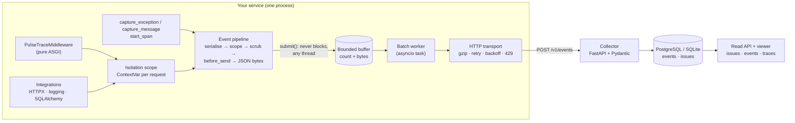

# Architecture

PulseTrace has four parts. The SDK is the product; the collector and viewer
exist to prove it end to end.



## 1. The event pipeline (request path)

Everything on the request path is synchronous, bounded and exception-safe:

1. **Capture.** `capture_exception` serialises the exception immediately
   (`exceptions.py`): type, message, chained causes, exception-group members and
   frames with source context. After this step the SDK holds no reference to
   the exception, its traceback or any frame.
2. **Scope.** The current isolation scope (`scope.py`) contributes tags, user,
   extra data, breadcrumbs and lazily built request information. The active span
   contributes `trace_id`/`span_id`.
3. **Scrub.** `processors.py` builds a redacted *copy*: sensitive keys
   (`Authorization`, `password`, `session_id`, ...) anywhere in the event, and
   payment card numbers (Luhn-checked), bearer tokens and URL passwords in free
   text.
4. **`before_send`.** The user's hook sees the scrubbed dict and may edit or
   drop it. If the hook raises, the event is dropped (privacy-safe default).
5. **Serialise.** `json.dumps` to bytes. Oversized events are shrunk once
   (breadcrumbs, spans beyond 100, source context) and dropped if still too big.
6. **Submit.** `transport.submit(bytes)` appends to the buffer or reports a
   drop. It never waits.

Serialising on the request path costs a little latency (measured in
`benchmarks/`), but it makes memory accounting exact (the buffer counts bytes,
not guesses) and means nothing user-owned lives in the queue.

## 2. Concurrency model

| Who | Runs where | Touches |
|---|---|---|
| Request handlers (`async def`) | event loop thread | scopes (via `ContextVar`), `submit()` |
| `def` endpoints, logging calls, background threads | any thread | scopes (locked), `submit()` |
| Transport worker | one asyncio task on the loop | buffer consumer, HTTP |
| `start_in_background()` (sync apps) | private loop on a daemon thread | same worker, same buffer |

The buffer is a `deque` behind a `threading.Lock` (held for a few hundred
nanoseconds, never across I/O). A producer on another thread wakes the worker
with `loop.call_soon_threadsafe`, and only when the worker is actually waiting.
`asyncio.Queue` was rejected because it is not thread-safe; see
[design decisions](design_decisions.md#3-a-thread-safe-buffer-instead-of-asyncioqueue).

## 3. Context propagation

Each request runs in an isolation scope stored in a `ContextVar`. The middleware
forks a new scope, `set`s it, and `reset`s it with the token in `finally`, so
even a cancelled request restores the previous value. Spans use a second
`ContextVar`, so nested `start_span` calls form a tree automatically.

Measured behaviour across execution boundaries (`tests/concurrency/`):

| Boundary | Inherits the request's scope? |
|---|---|
| `await` in the same task | yes |
| `asyncio.create_task` | yes (copied at creation) |
| `asyncio.to_thread` | yes |
| `anyio.to_thread.run_sync` (FastAPI `def` endpoints) | yes |
| SQLAlchemy async greenlets | yes |
| `loop.run_in_executor` | **no**, so wrap the callable with `pulsetrace.bind_context` |
| `threading.Thread` | **no**, so wrap the target with `pulsetrace.bind_context` |

A copied context shares the *objects* its variables point to, which is why every
request gets a forked scope object rather than mutating an inherited one.

## 4. The transport

```text
submit() ──► EventBuffer ──► next_batch() ──► deliver(batch) ──► POST /v1/events
             bounded         size OR linger    retry loop         gzip JSON envelope
```

* **Batching.** A batch is sent when it reaches `max_batch_size` (100) or
  `flush_interval` (1 s) after its first event, or immediately when a flush or
  shutdown is waiting.
* **Outcomes.** 2xx delivered; 400/422 rejected (no retry); 401/403/404 and
  redirects are configuration errors (no retry, logged once per minute); 413
  splits the batch; 408/5xx/timeouts/network errors retry with jittered
  exponential backoff; 429 and 503 honour `Retry-After` (capped at
  `max_retry_after`).
* **Transport-wide pause.** After a failure, the backoff/`Retry-After` window
  applies to the next batch as well, so a down collector is not hammered by
  every batch in turn. The failure streak resets on the first success.
* **Accounting.** `accepted = delivered + dropped(by reason) + buffered + in-flight`
  holds at all times; `stats()` exposes every term.

### Lifecycle

| Call | Behaviour |
|---|---|
| `await start()` | binds the buffer to the running loop, creates the HTTP client, starts the worker in an *empty* `contextvars.Context` with instrumentation suppressed |
| `await flush(t)` | waits until every event accepted before the call is delivered or permanently dropped; returns `False` at the deadline |
| `await shutdown(t)` | stops accepting, drains without lingering, sends the final partial batch, cancels the worker at the deadline, closes the HTTP client, returns `ShutdownReport(delivered, dropped, unsent, elapsed)` |
| `start_in_background()` / `shutdown_sync()` | the same, on a private loop thread, plus an `atexit` flush (2 s) |

Events captured before `start()` wait in the buffer (bounded) and are delivered
once the worker starts.

## 5. Tracing

The first span in a service is its **transaction** (`op="http.server"` for
requests). Children are recorded as plain data when they finish, and the
transaction is sent as one event when it finishes. Durations come from
`perf_counter_ns`; only the transaction start reads the wall clock, and child
timestamps are derived from it by monotonic offsets.

The sampling decision is made once per trace, from a 64-bit BLAKE2b hash of the
trace id (`sampling.py`). Unsampled traces still propagate `traceparent` (with
flag `00`) and still give error events their trace id; they just record no spans.

## 6. The collector

* `POST /v1/events`: optional bearer API keys (constant-time comparison), body
  limit, gzip with a decompressed-size cap (zip-bomb safe), Pydantic validation
  *per event* (one bad event cannot sink a batch), optional token-bucket rate
  limiting (429 + `Retry-After`) and failure injection for demos.
* Storage: `INSERT ... ON CONFLICT (event_id) DO NOTHING RETURNING event_id`,
  then issue upserts for only the newly inserted events, in sorted fingerprint
  order, inside one transaction. Redelivered batches therefore change nothing.
* Grouping (`grouping.py`): see
  [design decisions](design_decisions.md#9-issue-fingerprints).
* Read side: `/events`, `/events/{id}`, `/issues`, `/issues/{fingerprint}`,
  `/traces/{trace_id}` (stitches all services' transactions into one span tree),
  `/stats`, `/health`, plus a server-rendered viewer under `/ui/`.
